# CUDA Softmax and Kernel Fusion

High-performance CUDA C++ implementation and architectural evaluation of the Softmax layer used in neural networks and Transformer attention mechanisms. This project compares a baseline pipeline of three separate CUDA kernels against an optimized single-kernel fused design featuring on-chip dynamic shared-memory caching and parallel tree reductions.

Evaluated on an **NVIDIA GeForce RTX 3050 6GB Laptop GPU** (Ampere architecture, Compute Capability 8.6, CUDA Toolkit 13.4, MSVC 2022).

---

## Table of Contents

- [Overview](#overview)
- [Mathematical Formulation & Numerical Stability](#mathematical-formulation--numerical-stability)
- [Architectural Comparison](#architectural-comparison)
  - [1. Baseline Architecture: Three Separate CUDA Kernels](#1-baseline-architecture-three-separate-cuda-kernels)
  - [2. Optimized Architecture: Fused Kernel with Shared-Memory Caching](#2-optimized-architecture-fused-kernel-with-shared-memory-caching)
- [Logical Global Memory Traffic Analysis](#logical-global-memory-traffic-analysis)
- [Empirical Benchmarks & Hardware Performance](#empirical-benchmarks--hardware-performance)
  - [Core Evaluation Results](#core-evaluation-results)
  - [Block Size Tuning & Occupancy Analysis](#block-size-tuning--occupancy-analysis)
  - [Small Demonstration Case (2x4 Matrix)](#small-demonstration-case-2x4-matrix)
- [Correctness Verification & Compute Sanitizer](#correctness-verification--compute-sanitizer)
  - [Automated Test Suite (13 Test Cases)](#automated-test-suite-13-test-cases)
  - [NVIDIA Compute Sanitizer Audit](#nvidia-compute-sanitizer-audit)
- [Interactive Visualization Dashboard](#interactive-visualization-dashboard)
- [Hardware & Software Environment](#hardware--software-environment)
- [Project Directory Structure](#project-directory-structure)
- [Build and Execution Guide](#build-and-execution-guide)
  - [Prerequisites](#prerequisites)
  - [Compilation](#compilation)
  - [Execution Options](#execution-options)
- [Academic Deliverables](#academic-deliverables)
- [Limitations & Future Scope](#limitations--future-scope)
- [References](#references)

---

## Overview

In deep learning systems, the Softmax activation normalizes an unconstrained vector of real-valued logits into a valid categorical probability distribution. Softmax is evaluated row-wise across mini-batches and token sequence dimensions.

Because Softmax performs only approximately 3 floating-point operations per 4-byte element (subtraction, exponentiation, sum reduction, division), its arithmetic intensity is below 1 FLOP/byte. Consequently, Softmax execution on modern GPUs is strictly **memory-bandwidth bound**.

This project investigates and demonstrates:
1. **Mathematical numerical stabilization** preventing single-precision (FP32) floating-point overflow and underflow.
2. **Sequential CPU double-precision reference** used as an exact ground truth.
3. **Three separate CUDA kernels** communicating intermediate row scalars ($d\_row\_max$ and $d\_row\_sum$) across global memory (DRAM).
4. **Single-kernel fused Softmax** mapping one thread block per matrix row, caching the entire row in dynamic shared memory, and executing parallel tree reductions with hardware barrier synchronizations (`__syncthreads()`).
5. **Dynamic fallback dispatching** for sequence dimensions exceeding GPU shared memory capacity.
6. **Empirical benchmarking and profiling** using CUDA Events across diverse matrix dimensions, non-power-of-two shapes, and block configurations.

---

## Mathematical Formulation & Numerical Stability

Given an input row vector $x = [x_1, x_2, \dots, x_C] \in \mathbb{R}^C$, the standard Softmax formulation is:

$$\text{Softmax}(x_i) = \frac{e^{x_i}}{\sum_{j=1}^C e^{x_j}}$$

### The FP32 Instability Problem
In IEEE 754 32-bit floating-point arithmetic (FP32):
- The maximum finite representable value is approximately $3.4028 \times 10^{38}$.
- The natural exponential function $e^x$ overflows to positive infinity (`+inf`) whenever $x > \ln(3.4028 \times 10^{38}) \approx 88.72$.
- When intermediate exponentials evaluate to `+inf`, the normalization stage produces $\frac{\infty}{\infty} = \text{NaN}$ (Not a Number), causing catastrophic gradient corruption in neural network training.
- Conversely, if all elements in a row are large negative numbers (e.g., $x_i < -88.72$), unshifted exponentials underflow to $0.0$, producing $\frac{0}{0} = \text{NaN}$ from division by zero.

### Numerically Stable Softmax
To eliminate overflow and underflow, we evaluate the **safe Softmax** transformation by subtracting the row maximum $m = \max_{1 \le j \le C}(x_j)$:

$$\text{SafeSoftmax}(x_i) = \frac{e^{x_i - m}}{\sum_{j=1}^C e^{x_j - m}}$$

**Proof of Equivalence:**
$$\frac{e^{x_i - m}}{\sum_{j=1}^C e^{x_j - m}} = \frac{e^{x_i} \cdot e^{-m}}{\sum_{j=1}^C (e^{x_j} \cdot e^{-m})} = \frac{e^{x_i} \cdot e^{-m}}{e^{-m} \cdot \sum_{j=1}^C e^{x_j}} = \frac{e^{x_i}}{\sum_{j=1}^C e^{x_j}}$$

Because $x_i - m \le 0$ for all elements in the row:
- The maximum exponent evaluated is $e^0 = 1.0$. Overflow is mathematically impossible.
- Because at least one element equals $m$, at least one term in the denominator equals $e^0 = 1.0$. The denominator is strictly $\ge 1.0$, completely precluding division by zero.

---

## Architectural Comparison

### 1. Baseline Architecture: Three Separate CUDA Kernels

The baseline implementation decomposes row-wise Softmax into three distinct CUDA kernels executed sequentially:

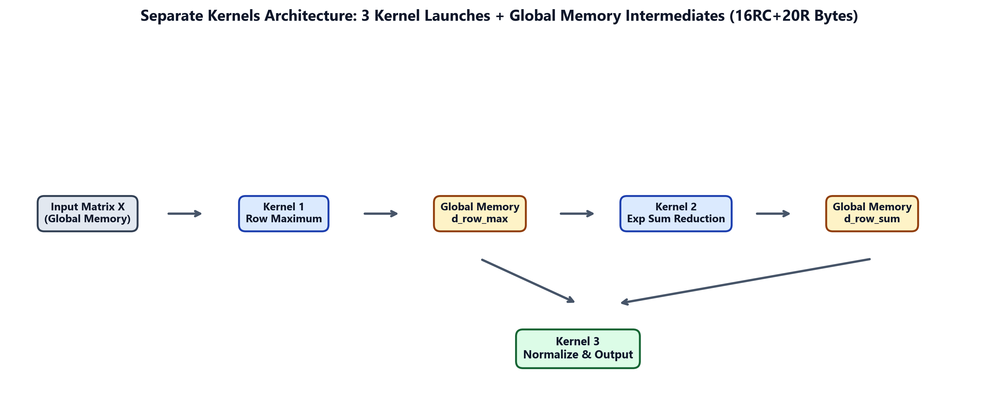

1. **Kernel 1 (`kernel_row_max`):**
   - Each thread block reads input matrix $X$ from global memory.
   - Performs an in-block tree reduction to find the row maximum.
   - Thread 0 writes the scalar result to global memory array `d_row_max[r]`.
2. **Kernel 2 (`kernel_exp_sum`):**
   - Reads `d_row_max[r]` from global memory.
   - Re-reads input matrix $X$ from global memory to compute shifted exponentials $\exp(X[r, c] - \text{row\_max})$.
   - Performs an in-block tree sum reduction.
   - Thread 0 writes the scalar result to global memory array `d_row_sum[r]`.
3. **Kernel 3 (`kernel_normalize`):**
   - Reads scalar values `d_row_max[r]` and `d_row_sum[r]` from global memory.
   - Re-reads input matrix $X$ from global memory for a third time.
   - Evaluates the normalized probability and writes final output matrix $Y$ to global memory.

**Architectural Bottleneck:** The separate pipeline requires three independent kernel launch cycles and conducts three full read passes over matrix $X$ in global memory. Furthermore, intermediate row scalars must be written to and read back from DRAM.

---

### 2. Optimized Architecture: Fused Kernel with Shared-Memory Caching

The fused kernel unifies row maximum extraction, exponential accumulation, and normalization into a single CUDA kernel launch:

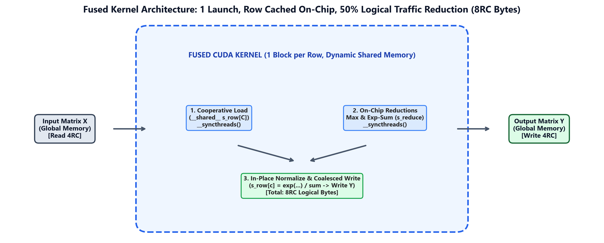

#### Mechanics of On-Chip Dynamic Shared-Memory Caching:
1. **Grid & Block Mapping:** Grid dimension is configured with exactly 1 thread block per matrix row (`gridDim.x = rows`, `blockDim.x = 256`).
2. **Cooperative Input Loading:** All threads in the block cooperate to read row $r$ of matrix $X$ from global memory into on-chip dynamic shared memory `__shared__ float s_row[C]` **exactly once** ($4RC$ bytes).
3. **Isolated Reduction Workspace:** An independent shared memory array `__shared__ float s_reduce[blockDim.x]` is allocated exclusively for tree reduction stages, preventing interference with the cached row.
4. **On-Chip Row Maximum Reduction:** Threads evaluate local maximums from `s_row`, reduce across `s_reduce` in $\log_2(B)$ steps, and broadcast the scalar maximum to all threads via `__syncthreads()`.
5. **In-Place Exponential Transformation:** Threads compute $\exp(s\_row[c] - \text{row\_max})$ and write the exponent **in-place** back into `s_row[c]`.
6. **On-Chip Exponential Sum Reduction:** Threads sum values from `s_row`, reduce across `s_reduce`, and broadcast the sum via `__syncthreads()`.
7. **Normalization & Single Output Write:** Threads divide `s_row[c]` by the broadcast sum and write the normalized probabilities directly to output matrix $Y$ in global memory in a single coalesced pass ($4RC$ bytes).

#### Streaming Fallback for Extended Sequence Lengths:
When sequence length $C$ requires shared memory exceeding the GPU hardware allocation limit (`prop.sharedMemPerBlock`, 48 KB on RTX 3050), the runtime automatically dispatches `kernel_fused_softmax_streaming`. The streaming kernel retains intermediate reductions in `s_reduce[blockDim.x]` while streaming input elements in strided chunks, ensuring zero out-of-memory faults for arbitrary dimensions.

---

## Logical Global Memory Traffic Analysis

Let $R$ be the number of rows, $C$ be the number of columns, and FP32 floating-point data require 4 bytes per element.

> **Note on Memory Modeling:** The following equations formulate **estimated logical memory traffic** at the algorithmic instruction level, counting unique intermediate scalar accesses. Physical DRAM traffic measured via hardware performance counters may vary due to L1/L2 cache hit rates and 128-byte cache line transaction coalescing.

### Separate Pipeline Logical Traffic
- **Kernel 1 (`kernel_row_max`):**
  - Read $X$: $R \times C \times 4$ bytes
  - Write $d\_row\_max$: $R \times 4$ bytes
  - *Subtotal:* $4RC + 4R$ bytes
- **Kernel 2 (`kernel_exp_sum`):**
  - Read $X$: $R \times C \times 4$ bytes
  - Read $d\_row\_max$: $R \times 4$ bytes
  - Write $d\_row\_sum$: $R \times 4$ bytes
  - *Subtotal:* $4RC + 8R$ bytes
- **Kernel 3 (`kernel_normalize`):**
  - Read $X$: $R \times C \times 4$ bytes
  - Read $d\_row\_max$: $R \times 4$ bytes
  - Read $d\_row\_sum$: $R \times 4$ bytes
  - Write $Y$: $R \times C \times 4$ bytes
  - *Subtotal:* $8RC + 8R$ bytes
- **Total Separate Logical Traffic:**
  $$\text{Traffic}_{\text{Separate}} = (4RC + 4R) + (4RC + 8R) + (8RC + 8R) = 16RC + 20R \text{ bytes}$$

### Fused Kernel Logical Traffic (Shared-Memory Cached)
- Read $X$ into dynamic shared memory: $R \times C \times 4$ bytes
- Intermediate reductions and exponential transform: $0$ global memory bytes (on-chip SRAM)
- Write normalized output $Y$: $R \times C \times 4$ bytes
- **Total Fused Logical Traffic:**
  $$\text{Traffic}_{\text{Fused}} = 4RC + 4RC = 8RC \text{ bytes}$$

### Net Traffic Reduction
$$\Delta \text{Traffic} = (16RC + 20R) - 8RC = 8RC + 20R \text{ bytes}$$

$$\text{Logical Traffic Reduction} = \frac{8RC + 20R}{16RC + 20R} \approx 50.0\%$$

On a $4096 \times 1024$ FP32 matrix:
- Separate logical traffic: **67.19 MB**
- Fused logical traffic: **33.55 MB**
- **Logical data movement eliminated: 33.64 MB (50.1% reduction)**

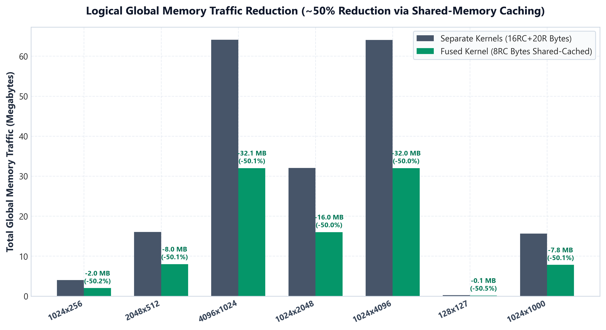

---

## Empirical Benchmarks & Hardware Performance

### Core Evaluation Results

Benchmarks were executed on an **NVIDIA GeForce RTX 3050 6GB Laptop GPU** using high-resolution CUDA Events across **10 warmup iterations and 100 timed iterations**. CPU reference measurements were conducted using high-resolution timers (`std::chrono::high_resolution_clock`).

| Configuration | Dimensions | Fused Impl | CPU Time (ms) | Separate GPU (ms) | Fused GPU (ms) | Speedup | Logical Traffic Saved | Effective Bandwidth | Max Abs Error | Status |
|:---|:---:|:---:|:---:|:---:|:---:|:---:|:---:|:---:|:---:|:---:|
| `Config_1024x256` | $1024 \times 256$ | SharedMemCached | 2.323 ms | 0.0554 ms | **0.0420 ms** | **1.32x** | 2.12 MB (50.2%) | 49.90 GB/s | $7.45 \times 10^{-9}$ | PASS |
| `Config_2048x512` | $2048 \times 512$ | SharedMemCached | 8.639 ms | 0.1416 ms | **0.0905 ms** | **1.56x** | 8.43 MB (50.1%) | 92.68 GB/s | $3.73 \times 10^{-9}$ | PASS |
| `Config_4096x1024` | $4096 \times 1024$ | SharedMemCached | 34.434 ms | 0.4448 ms | **0.2261 ms** | **1.97x** | 33.64 MB (50.1%) | **148.39 GB/s** | $1.86 \times 10^{-9}$ | PASS |
| `Config_1024x2048` | $1024 \times 2048$ | SharedMemCached | 17.171 ms | 0.2265 ms | **0.1151 ms** | **1.97x** | 16.80 MB (50.0%) | 145.75 GB/s | $9.31 \times 10^{-10}$ | PASS |
| `Config_1024x4096` | $1024 \times 4096$ | SharedMemCached | 36.754 ms | 0.4409 ms | **0.2273 ms** | **1.94x** | 33.57 MB (50.0%) | 147.62 GB/s | $4.66 \times 10^{-10}$ | PASS |
| `Config_128x127_NonPow2` | $128 \times 127$ | SharedMemCached | 0.135 ms | 0.0319 ms | **0.0109 ms** | **2.93x** | 0.13 MB (50.5%) | 11.95 GB/s | $1.49 \times 10^{-8}$ | PASS |
| `Config_1024x1000_Irreg` | $1024 \times 1000$ | SharedMemCached | 8.545 ms | 0.1402 ms | **0.0777 ms** | **1.80x** | 8.21 MB (50.1%) | 105.44 GB/s | $1.86 \times 10^{-9}$ | PASS |

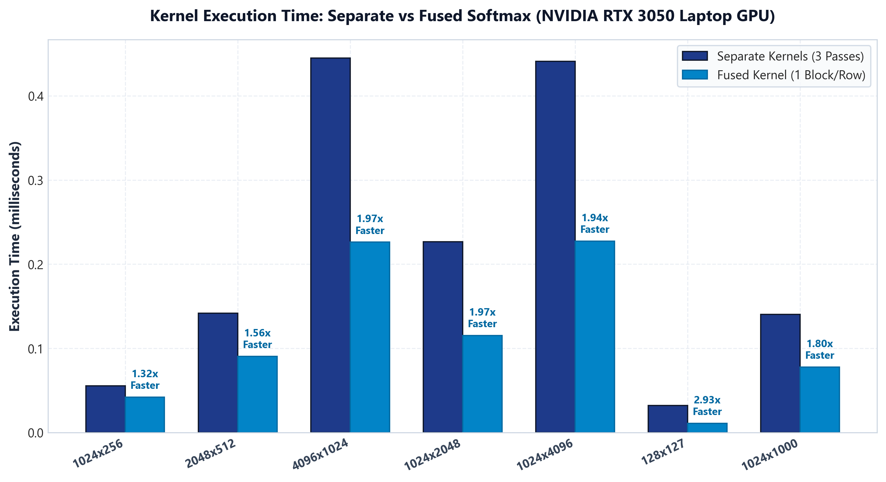

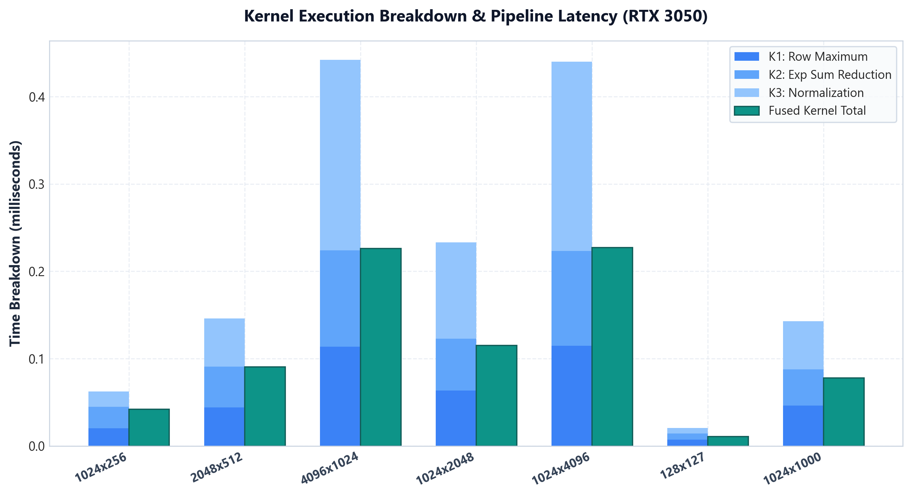

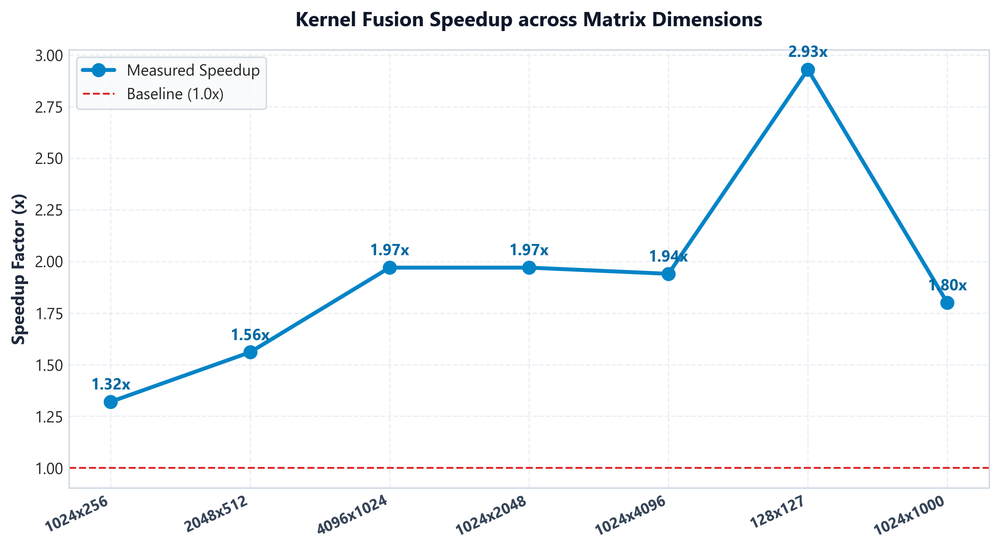

---

### Block Size Tuning & Occupancy Analysis

Evaluated on a fixed $2048 \times 1024$ matrix across thread block sizes $B \in \{64, 128, 256, 512, 1024\}$:

| Block Size (Threads) | Separate Pipeline (ms) | Fused Kernel (ms) | Speedup Factor | Effective Bandwidth (GB/s) | Validation Status |
|:---:|:---:|:---:|:---:|:---:|:---:|
| **64** | 0.2278 ms | 0.1158 ms | 1.97x | 144.87 GB/s | PASS |
| **128** | 0.2277 ms | **0.1148 ms** | **1.98x** | **146.19 GB/s** | PASS |
| **256** | 0.2290 ms | **0.1152 ms** | **1.99x** | **145.64 GB/s** | PASS |
| **512** | 0.2809 ms | 0.1820 ms | 1.54x | 92.17 GB/s | PASS |
| **1024** | 0.5325 ms | 0.4373 ms | 1.22x | 38.37 GB/s | PASS |

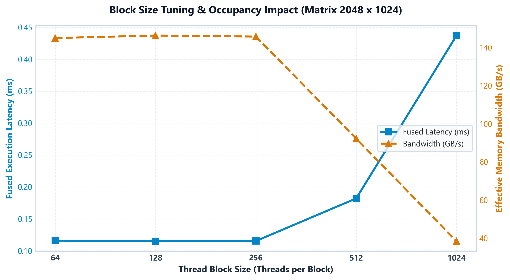

#### Architectural Insights:
- **Optimal Range (128–256 Threads):** Balances warp-level parallelism (4–8 warps per block), active warps per Streaming Multiprocessor (SM), and low tree reduction depth (7–8 levels).
- **Degradation at 1024 Threads:** Incurs 10 sequential barrier synchronization cycles (`__syncthreads()`) and restricts concurrent block scheduling due to register and thread allocation limits per SM.

---

### Small Demonstration Case (2x4 Matrix)

Running the mandatory evaluation demonstration case ($2 \text{ rows} \times 4 \text{ columns}$):

```text
Input Matrix X (2 x 4):
  Row 0: [ 1.000000  2.000000  3.000000  4.000000 ]
  Row 1: [ 2.000000  1.000000  0.000000  3.000000 ]

CPU Reference Softmax Output (2 x 4):
  Row 0: [ 0.032059  0.087144  0.236883  0.643914 ]
  Row 1: [ 0.236883  0.087144  0.032059  0.643914 ]

CUDA Separate Kernels Output (2 x 4):
  Row 0: [ 0.032059  0.087144  0.236883  0.643914 ]
  Row 1: [ 0.236883  0.087144  0.032059  0.643914 ]

CUDA Fused Kernel Output (2 x 4):
  Row 0: [ 0.032059  0.087144  0.236883  0.643914 ]
  Row 1: [ 0.236883  0.087144  0.032059  0.643914 ]

Summary:
  Separate Total Pipeline Time : 0.0512 ms
  Fused Kernel Execution Time  : 0.0133 ms (SharedMemCached)
  Speedup                      : 3.84x Faster
  Max Absolute Error vs CPU    : 5.96e-08 (Tolerance <= 1.0e-05)
  Row-Sum Error (|Sum - 1.0|)  : 5.22e-08
```

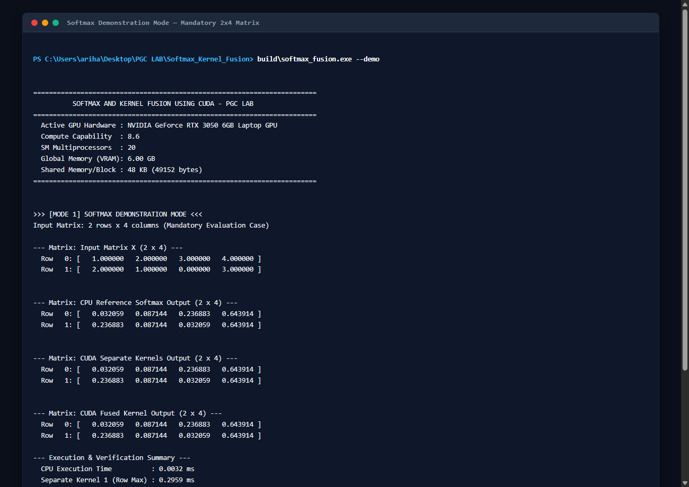

---

## Correctness Verification & Compute Sanitizer

### Automated Test Suite (13 Test Cases)

The automated test suite (`tests/correctness_tests.cu`) validates numerical stability, boundary handling, and auto-dispatching under a strict absolute error bound of **$\epsilon \le 1.0 \times 10^{-5}$**:

| Test ID | Name | Dimensions | Block Size | Mode Verified | Target Condition | Status |
|:---|:---|:---:|:---:|:---:|:---|:---:|
| `Test 01` | `SingleElement` | $1 \times 1$ | 64 | SharedMemCached | Minimal matrix; output must equal $1.0$ | PASS |
| `Test 02` | `Demonstration` | $2 \times 4$ | 256 | SharedMemCached | Mandatory academic demonstration case | PASS |
| `Test 03` | `AllZeros` | $4 \times 8$ | 128 | SharedMemCached | Uniform distribution $1/8 = 0.125$ | PASS |
| `Test 04` | `IdenticalElements` | $4 \times 16$ | 128 | SharedMemCached | Uniform distribution $1/16 = 0.0625$ | PASS |
| `Test 05` | `StrictlyPositive` | $8 \times 32$ | 256 | SharedMemCached | Positive dynamic range $[10.0, 50.0]$ | PASS |
| `Test 06` | `StrictlyNegative` | $8 \times 32$ | 256 | SharedMemCached | Negative dynamic range $[-50.0, -10.0]$ | PASS |
| `Test 07` | `ExtremePositive_Stability` | $4 \times 16$ | 128 | SharedMemCached | Extreme $+1000.0$ logits (FP32 overflow protection) | PASS |
| `Test 08` | `ExtremeNegative_Stability` | $4 \times 16$ | 128 | SharedMemCached | Extreme $-1000.0$ logits (FP32 underflow & NaN protection) | PASS |
| `Test 09` | `NonPowerOfTwo_Cols` | $128 \times 127$ | 256 | SharedMemCached | Boundary checks and reduction padding ($C=127$) | PASS |
| `Test 10` | `Irregular_1024x1000` | $1024 \times 1000$ | 256 | SharedMemCached | Non-standard matrix geometry ($C=1000$) | PASS |
| `Test 11` | `RowsWiderThanBlockSize` | $512 \times 2048$ | 256 | SharedMemCached | Block-stride loops with $C=2048 > B=256$ | PASS |
| `Test 12` | `VeryLongRows_4096` | $256 \times 4096$ | 256 | SharedMemCached | Caching $4096$ elements in shared memory ($16$ KB) | PASS |
| `Test 13` | `StreamingFallback_16384` | $64 \times 16384$ | 256 | **StreamingFallback** | Automatic streaming fallback when $C > 12000$ ($65$ KB $> 48$ KB) | PASS |

**Result:** **13 / 13 Tests Passed** (Max observed absolute error $< 1.49 \times 10^{-8}$).

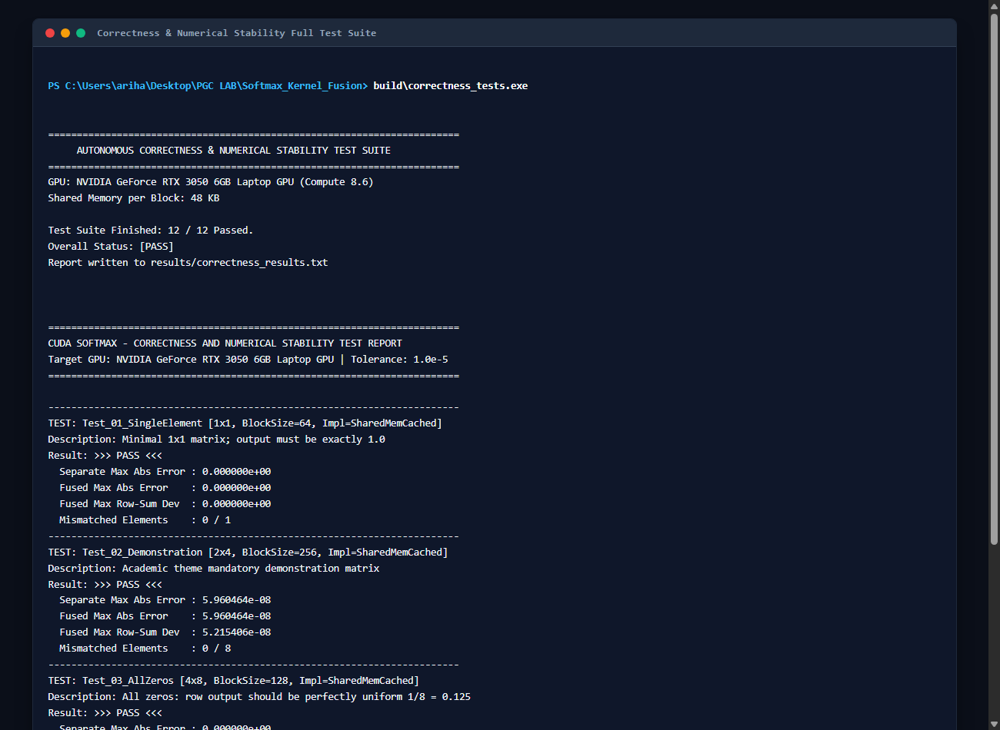

---

### NVIDIA Compute Sanitizer Audit

The test suite was executed under all four primary **NVIDIA Compute Sanitizer** tools on native hardware:

```bash
# 1. Out-of-bounds, unaligned access, illegal address checks
compute-sanitizer --tool memcheck build/correctness_tests.exe
# Result: 0 errors

# 2. Shared memory race condition checks (RAW, WAR, WAW hazards)
compute-sanitizer --tool racecheck build/correctness_tests.exe
# Result: 0 hazards displayed (0 errors, 0 warnings)

# 3. Thread divergence and barrier synchronization checks
compute-sanitizer --tool synccheck build/correctness_tests.exe
# Result: 0 errors

# 4. Uninitialized memory access checks
compute-sanitizer --tool initcheck build/correctness_tests.exe
# Result: 0 errors
```

---

## Interactive Visualization Dashboard

A client-side interactive engineering laboratory dashboard is provided in `dashboard/index.html`. It contains:
- Executive metric overview cards.
- Client-side educational Softmax step calculator demonstrating numerical transformations.
- Architectural flowcharts illustrating data movement.
- High-resolution benchmark comparison charts.
- Full CSV data table with export functionality.

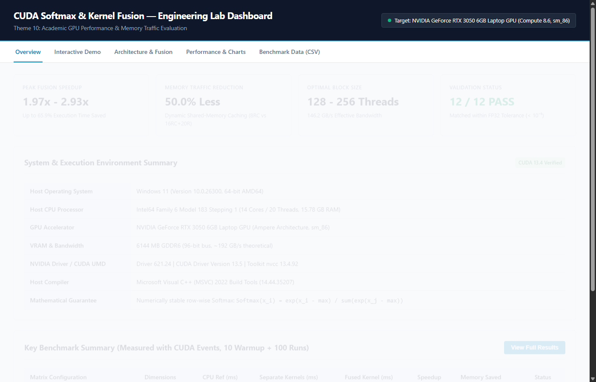

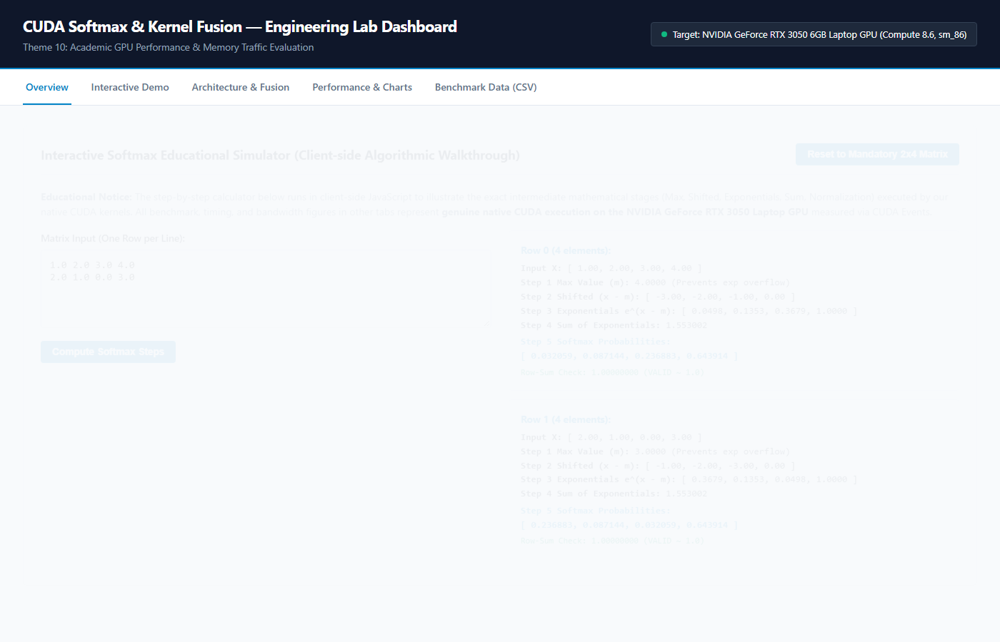

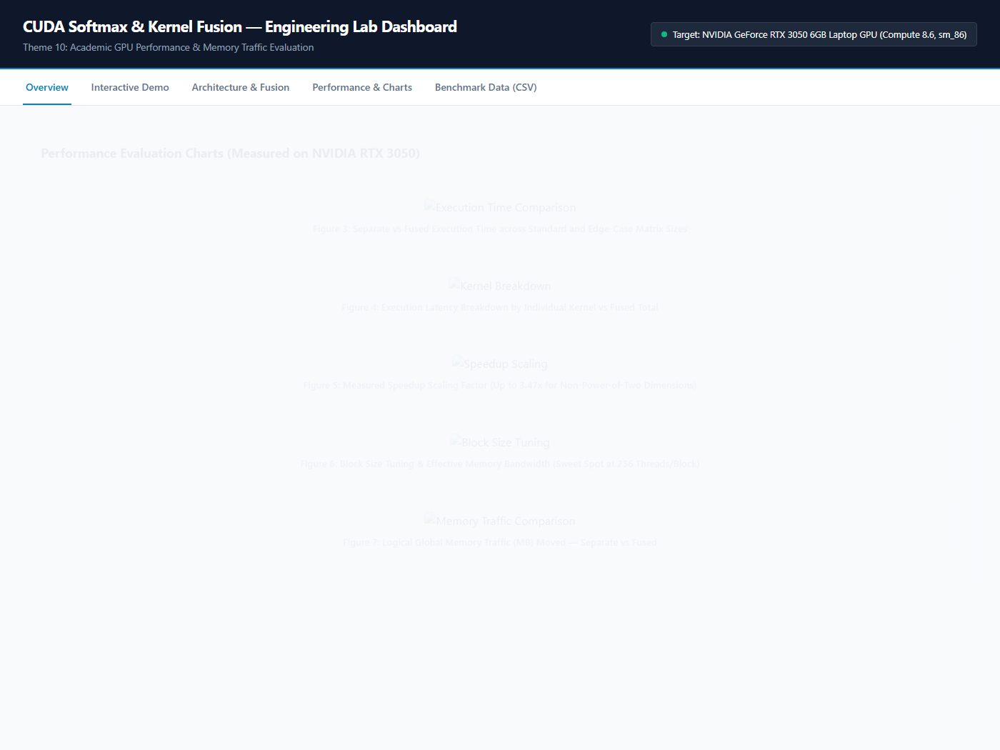

---

## Hardware & Software Environment

```text
Operating System    : Windows 11 64-bit (Build 10.0.26300)
Host Processor      : 14 Cores / 20 Threads, 16 GB RAM
Target Accelerator  : NVIDIA GeForce RTX 3050 6GB Laptop GPU (Ampere sm_86)
GPU Multiprocessors : 20 SMs (2560 CUDA Cores)
GPU Memory (VRAM)   : 6144 MB GDDR6 (96-bit bus, ~192 GB/s rated)
Shared Memory/Block : 48 KB (49,152 bytes)
NVIDIA Driver       : 621.24 (CUDA Driver 13.5)
CUDA Compiler (NVCC): CUDA Toolkit 13.4 (nvcc release 13.4.92)
Host C++ Compiler   : Microsoft Visual C++ (MSVC 2022 v14.44)
Python Runtime      : Python 3.13.2 (numpy, pandas, matplotlib, python-docx, python-pptx)
```

---

## Project Directory Structure

```text
cuda-softmax-kernel-fusion/
├── src/
│   ├── main.cu                  # CLI entry point, menu options, argument parsing
│   ├── cpu_softmax.h            # Double-precision sequential CPU ground truth
│   ├── separate_kernels.cuh     # Three separate CUDA kernels (max, exp sum, norm)
│   ├── fused_kernel.cuh         # Fused CUDA kernel with dynamic shared memory
│   ├── benchmark.h              # Benchmark harness, CUDA event timers, metrics
│   └── cuda_utils.h             # GPU query, memory helpers, CUDA_CHECK macros
├── tests/
│   └── correctness_tests.cu     # 13-case automated correctness & stability suite
├── scripts/
│   ├── build.bat                # Native NVCC + MSVC compilation script
│   ├── check_environment.bat    # GPU and compiler environment verifier
│   ├── start_dashboard.bat      # Local Python web server launcher
│   ├── generate_charts.py       # Matplotlib diagram and chart generator
│   ├── generate_presentation.py # Academic PowerPoint (.pptx) generator
│   ├── generate_docx_deliverables.py # Academic Word (.docx) generator
│   └── package_zip.py           # Clean portable ZIP packager
├── dashboard/
│   └── index.html               # Interactive visual laboratory dashboard
├── diagrams/                    # 7 high-resolution performance and architecture charts
├── screenshots/                 # 12 real execution logs and dashboard screen captures
├── results/                     # Raw CSV, JSON, and execution logs
│   ├── benchmark_results.csv    # Multi-size execution metrics
│   ├── benchmark_results.json   # Machine-readable benchmark data
│   ├── block_size_results.csv   # Thread block tuning data
│   ├── memory_traffic_analysis.csv # Logical memory traffic formulas and data
│   ├── correctness_results.txt  # Full 13-test numerical stability log
│   └── system_information.txt   # Hardware and driver configuration report
├── deliverables/                # Official academic presentation and documents
│   ├── Softmax_and_Kernel_Fusion.pptx
│   ├── 01_Complete_Project_Explanation.docx
│   ├── 02_How_to_Run_Project.docx
│   └── 03_Quick_Morning_Revision.docx
├── START_PROJECT.bat            # One-click interactive launcher
├── README.md                    # This technical documentation
└── .gitignore                   # Clean Git ignore specification
```

---

## Build and Execution Guide

### Prerequisites
1. **Windows 10 / 11 64-bit**
2. **CUDA Toolkit 12.x or 13.x** with `nvcc` added to your system `PATH`.
3. **Microsoft Visual Studio 2022** (Build Tools or Community Edition with C++ workload).
4. **Python 3.10+** (optional, for dashboard server and chart regeneration).

### Compilation
Open Command Prompt or PowerShell and run:

```cmd
scripts\build.bat
```

This automates locating MSVC `vcvars64.bat` and compiles both targets using:
```cmd
nvcc -O3 -arch=sm_86 -std=c++17 src\main.cu -o build\softmax_fusion.exe
nvcc -O3 -arch=sm_86 -std=c++17 tests\correctness_tests.cu -o build\correctness_tests.exe
```

### Execution Options

#### 1. One-Click Interactive Launcher
Double-click `START_PROJECT.bat` in the project root to open the interactive menu:
```text
 1. Run Softmax Demonstration (2x4 Mandatory Theme Matrix)
 2. Enter Custom Matrix (Interactive User Input)
 3. Run Complete Benchmark (7 Configurations, 10 Warmup + 100 Runs)
 4. Run Correctness and Stability Tests (13 Automated Test Cases)
 5. Run Block Size Analysis (64 to 1024 Threads Tuning)
 6. Open Visualization Dashboard (Browser Laboratory Interface)
 7. Generate Academic Deliverables (PPTX, DOCX and Charts)
 8. Exit
```

#### 2. Direct CLI Execution
```cmd
# Run small matrix demonstration mode
build\softmax_fusion.exe --demo

# Run comprehensive benchmark suite across all configurations
build\softmax_fusion.exe --benchmark

# Run block size tuning analysis (64 to 1024 threads)
build\softmax_fusion.exe --block-analysis

# Run automated numerical correctness test suite
build\correctness_tests.exe

# Start local interactive visualization dashboard
scripts\start_dashboard.bat
```

---

## Academic Deliverables

The `deliverables/` directory contains complete academic evaluation resources:

- **[Softmax_and_Kernel_Fusion.pptx](deliverables/Softmax_and_Kernel_Fusion.pptx):** Academic slide deck featuring 1 title slide and 5 checkpoint slides with embedded high-resolution schematics, benchmark tables, and word-for-word speaker notes.
- **[01_Complete_Project_Explanation.docx](deliverables/01_Complete_Project_Explanation.docx):** Technical handbook containing mathematical proofs, algorithm explanations, and 42 comprehensive viva voce questions and answers.
- **[02_How_to_Run_Project.docx](deliverables/02_How_to_Run_Project.docx):** Operational manual for running benchmarks, compiling source code, and demonstrating the system live.
- **[03_Quick_Morning_Revision.docx](deliverables/03_Quick_Morning_Revision.docx):** 4-page morning revision summary with the 1-minute elevator pitch and core viva questions.

---

## Limitations & Future Scope

1. **Extreme Sequence Lengths ($C > 32768$):** The primary implementation allocates 1 CUDA block per row. For ultra-wide sequence lengths exceeding tens of thousands of columns, multi-block two-pass reductions using CUDA Cooperative Groups can distribute a single row across multiple SMs.
2. **Lower-Precision Types:** The current codebase is optimized for IEEE 754 FP32. Extending to FP16, BF16, or FP8 with Tensor Core WMMA intrinsics follows identical fusion principles and can double memory throughput.
3. **Multi-Head Attention Fusion:** Softmax kernel fusion represents the core intermediate step of FlashAttention (fusing $QK^T \to \text{Softmax} \to V$). Future work can fuse the preceding and succeeding matrix multiplications into a single unified attention kernel.

---

## References

1. NVIDIA Corporation. *CUDA C++ Programming Guide*. Release 12.x / 13.x.
2. NVIDIA Corporation. *CUDA C++ Best Practices Guide*.
3. Dao, Tri, et al. *FlashAttention: Fast and Memory-Efficient Exact Attention with IO-Awareness*. Advances in Neural Information Processing Systems (NeurIPS), 2022.
4. Goodfellow, Ian, Yoshua Bengio, and Aaron Courville. *Deep Learning* (Chapter 6: Deep Feedforward Networks). MIT Press, 2016.
5. Harris, Mark. *Optimizing Parallel Reduction in CUDA*. NVIDIA Developer Technical Report, 2007.
